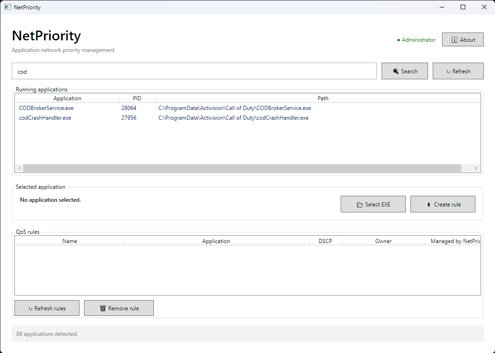

# NetPriority


**NetPriority** is a Windows desktop application for managing network priorities of applications through Windows QoS policies and DSCP values.

---

## Table of Contents

- [Features](#features)
- [Why NetPriority](#why-netpriority)
- [Screenshots](#screenshots)
- [Requirements](#requirements)
- [Installation](#installation)
- [Usage](#usage)
- [Default DSCP Profiles](#default-dscp-profiles)
- [Project Structure](#project-structure)
- [Building from Source](#building-from-source)
- [License](#license)
- [Author](#author)

---

## Features

- Lists running applications on the system.
- Allows searching and selecting an application.
- Allows manually selecting an `.exe` file.
- Creates QoS rules associated with an application and a DSCP value.
- Lists all QoS policies present on the system.
- Removes selected QoS policies (with confirmation for those not managed by NetPriority).
- Shows administrator privilege status.

---
## Why NetPriority

Three scenarios where Windows QoS and DSCP tagging make a measurable difference — without touching PowerShell or hidden system menus.

### 🎮 Lower latency in games

- Tags game traffic with **DSCP 46 (Gaming)** so routers that honor QoS give it priority over background downloads or streams.
- Prevents **lag spikes** caused by other devices on the same network saturating the link (bufferbloat).

### 🎥 Smooth streaming and calls

- **DSCP 34 (Video)** keeps Discord, Teams, Zoom or YouTube smooth when bandwidth is saturated.
- **DSCP 40 (Signaling)** protects VoIP audio from stuttering or degrading during heavy traffic.

### 🎛️ Full control, simple UI

- Manage everything from a **graphical interface**: pick a running process or a `.exe` file and click a button — no `netsh` or PowerShell required.
- Choose between **permanent rules** (kept after NetPriority closes) or **temporary rules** (cleaned up on exit).
- **Auto-detection** of running applications removes the need to hunt for executable paths on disk.

> **Note**: to fully benefit from DSCP tagging, your router must also support QoS and have it enabled for the marked packets.

---

## Screenshots

The main window: running applications, the selected target, and the current QoS rules.

<p align="center">
  
</p>

---

## Requirements

- **Windows 10 or later** (x64)
- **.NET Desktop Runtime 10 (x64)** — required

### Installing .NET Desktop Runtime 10 (x64)

NetPriority requires the **.NET Desktop Runtime 10** to run. You can install it in two ways.

**Method 1 — Manual download:**

1. Go to the official download page:  
   👉 [https://dotnet.microsoft.com/en-us/download/dotnet/10.0](https://dotnet.microsoft.com/en-us/download/dotnet/10.0)
2. In the **".NET Desktop Runtime"** section, download the **x64** version.
3. Run the installer and follow the instructions.

**Method 2 — Install via winget (recommended):**

Open a PowerShell or Command Prompt terminal and type:

```bash
winget install Microsoft.DotNet.DesktopRuntime.10
```

> **Warning**: make sure you install the **Desktop** version (not the base .NET Runtime), otherwise NetPriority will not work.

---

## Installation

1. Download the `NetPriority-v1.1.0-win-x64.zip` file from the [Releases](https://github.com/damarant/NetPriority/releases) section.
2. Extract the ZIP contents to a folder of your choice.
3. Make sure you have installed the **.NET Desktop Runtime 10 (x64)** (see above).
4. Launch `NetPriority.exe`. The application will request administrator privileges (UAC).

---

## Usage

1. **Start NetPriority** as administrator (required to create and remove QoS policies).
2. In the **"Running applications"** list, select the desired application, or use **"Select EXE"** to manually choose an executable file.
3. Click **"Create rule"**.
4. In the window that opens:
   - Enter a name for the rule (the `NetPriority_` prefix is recommended for automatic recognition).
   - Choose a predefined DSCP profile (Gaming, Video, Signaling) or select **"Custom"** to enter a manual value (0–63).
   - Check or uncheck **"Keep the rule when NetPriority is closed"**.
5. Confirm with **"Create"**.
6. The rule will appear in the **"QoS rules"** section. From here you can refresh the list or remove a selected rule.

---

## Default DSCP Profiles

| Profile   | DSCP Value |
|-----------|------------|
| Gaming    | 46         |
| Video     | 34         |
| Signaling | 40         |
| Custom    | 0–63       |

---

## Project Structure

```text
NetPriority/
├── App.xaml
├── App.xaml.cs
├── AssemblyInfo.cs
├── MainWindow.xaml
├── MainWindow.xaml.cs
├── CreatePolicyWindow.xaml
├── CreatePolicyWindow.xaml.cs
├── AboutWindow.xaml
├── AboutWindow.xaml.cs
├── Models/
│   ├── ApplicationInfo.cs
│   ├── QosProfile.cs
│   └── QosRule.cs
├── Services/
│   ├── ProcessService.cs
│   └── QosService.cs
├── NetPriority.csproj
├── app.manifest
├── .gitignore
├── LICENSE
└── README.md
```

---

## Building from Source

To compile NetPriority from source code:

1. Make sure you have the **.NET 10 SDK** installed.
2. Open a terminal in the project folder.
3. Run:

```bash
dotnet publish -c Release -r win-x64 --self-contained false
```

The output will be in `bin\Release\net10.0-windows\win-x64\publish\`.

---

## License

This project is distributed under the **MIT** license. See the [LICENSE](LICENSE) file for details.

Copyright (c) 2025 **damarant**.

---

## Author

**damarant**

- Version: **1.1.0**
- Year: **2025**

